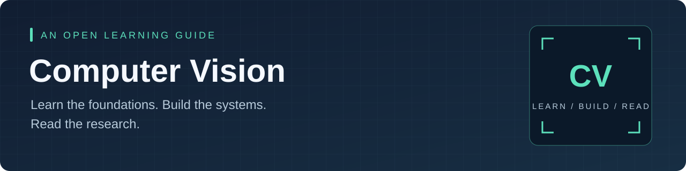
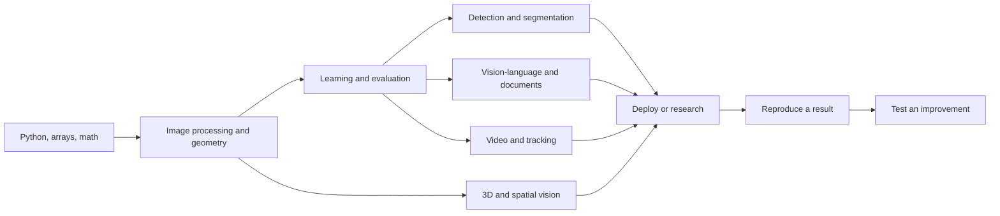

<p align="center">
  
</p>

<h1 align="center">Awesome Computer Vision 2026</h1>

<p align="center">
  <b>Roadmaps, 40 projects, 40 papers, interview prep, and runnable starter code.<br>One place to go from "I can write Python" to "I can evaluate a vision system."</b>
</p>

<p align="center">
  <a href="LICENSE"></a>
  
  
  
  
  <a href="CONTRIBUTING.md"></a>
</p>

<p align="center">
  <a href="#start-here">Start here</a> ·
  <a href="roadmaps/README.md">Roadmaps</a> ·
  <a href="projects/README.md">Projects</a> ·
  <a href="research/paper-reading.md">Papers</a> ·
  <a href="resources/README.md">Resources</a> ·
  <a href="career/interview-preparation.md">Interviews</a>
</p>

---

> **Most computer vision lists give you 500 links and no order.**
> This one gives you a path, a project for every step, and a way to tell whether your model actually works.

It is built around the three questions every learner hits:

| | |
|---|---|
| 🧭 **What should I study next?** | Opinionated roadmaps with weekly deliverables and mastery checks |
| 🔨 **What can I build with my hardware?** | 40 project briefs, each labeled CPU, one GPU, or high compute |
| ✅ **How do I know it works?** | An evaluation guide and a failure-first habit that most tutorials skip |

## After this repo you can

- Split data without leaking it, pick the right metric for the task, and put an error bar on a result.
- Take a paper from abstract to a small, honest reproduction, and test one improvement.
- Ship a model with a latency number you measured, not guessed.
- Show a portfolio where someone can run one command and see your result.

## Start here

| If you are... | Go to | You will finish with |
| --- | --- | --- |
| 🌱 New to Python, ML, or vision | [24-week beginner-to-job-ready path](roadmaps/beginner-to-job-ready.md) | Fundamentals, evaluated projects, a portfolio |
| 🔁 Returning to CV after a gap | [30-day refresh](roadmaps/30-day-refresh.md) | A skills audit and one complete experiment |
| 🔬 Ready to do research | [12-week research path](roadmaps/research.md) | A scoped question, a baseline, an ablation, a report |
| 🔨 Looking for something to build | [40 project briefs](projects/README.md) | Data, baseline code, metrics, failure analysis |
| 📄 Reading papers | [Paper reading path](research/paper-reading.md) | Notes, reproductions, controlled improvements |
| 🎤 Interviewing soon | [Interview prep](career/interview-preparation.md) | A four-week plan and 35 questions with answer cues |
| 💻 Laptop only | [Starter programs](examples/README.md) | Three CPU experiments, no model downloads |

Not sure where to begin? Take the [45-minute self-test](roadmaps/README.md#find-your-starting-point-in-45-minutes).

## Try it in one minute

```bash
git clone https://github.com/aishwaryanevrekar/awesome-computer-vision.git
cd awesome-computer-vision
python3 -m venv .venv && source .venv/bin/activate
make setup
make demo
```

That runs all three starters and writes results to `outputs/`:

| Program | What it shows | Result on a laptop CPU |
| --- | --- | --- |
| [`image_processing.py`](examples/image_processing.py) | Grayscale, blur, and Sobel gradients side by side | A comparison image, instantly |
| [`digits_baseline.py`](examples/digits_baseline.py) | A properly split classifier with a majority-class baseline | ~97% test accuracy vs 10% for the baseline |
| [`image_retrieval.py`](examples/image_retrieval.py) | Ranking a gallery by color histogram similarity | Ranked matches as JSON and a contact sheet |

Then explain, in your own words, what the edge map captures and where it fails. That habit is the whole repo.

## What is inside

| | |
| --- | --- |
| 🗺️ [**Roadmaps**](roadmaps/README.md) | 24-week, 12-week, and 30-day plans with mastery gates and compute options |
| 🧪 [**Projects**](projects/README.md) | 8 beginner, 16 intermediate, 16 advanced briefs across detection, segmentation, OCR, 3D, video, VLMs, and deployment |
| 📄 [**Papers**](research/paper-reading.md) | 40 papers in order, each with prerequisites and an experiment |
| 🔭 [**2026 landscape**](research/landscape.md) | What changed, with sources and concrete questions to test |
| 📚 [**Resource catalog**](resources/README.md) | 94 courses, books, models, tools, datasets, and benchmarks, also as [JSON](resources/catalog.json) |
| 📏 [**Evaluation guide**](guides/evaluation.md) | Splits, leakage, metrics per task, fair comparison, error analysis |
| 💻 [**Compute and setup**](guides/compute-and-setup.md) | CPU, Apple Silicon, CUDA, and how to budget experiments |
| ⚖️ [**Datasets and licenses**](guides/datasets-and-licenses.md) | Provenance, permissions, and what you may actually do with the data |
| 💼 [**Career**](career/portfolio.md) | Portfolio structure, résumé bullets, interview preparation |
| 🧰 [**Templates**](templates/) | Experiment report, paper note, study tracker |

The three starter programs are implemented here. The 40 project briefs describe what to build and link to upstream code; they are specifications, not finished apps.

## The map



Pick one course and one reference book for the core, then use the [catalog](resources/README.md) for gaps instead of collecting parallel courses.

## Read papers with a purpose

For every paper, answer five questions:

1. What changes relative to the baseline?
2. Which experiment supports that change?
3. What assumption might fail on my data?
4. What is the smallest affordable reproduction?
5. What single change would test my hypothesis?

Keep **the paper's result**, **your reproduction**, and **your improvement** in separate columns. A documented failed replication teaches more than an unexplained score gain. The [paper-note template](templates/paper-note.md) is built for this.

## Search the catalog from your terminal

No dependencies needed:

```bash
python3 scripts/catalog.py search segmentation
python3 scripts/catalog.py search --level beginner
python3 scripts/catalog.py search --category datasets --json
```

## FAQ

**Do I need a GPU?** No. Every project brief is labeled, and the starter programs and many beginner projects run on a CPU. The [compute guide](guides/compute-and-setup.md) covers Apple Silicon, CUDA, and budgeting.

**Is this a course?** No. It is a map plus exercises. Pair it with one course (CS231n and fast.ai are good picks) and one book.

**Why so much about evaluation?** Because the most common failure in computer vision is not a bad model, it is a number nobody should have believed. Leakage, wrong splits, and unmeasured latency sink more projects than architecture does.

**Are the projects solved?** No. They are briefs: dataset, baseline, metric, and a failure to chase. The implementation is the exercise.

**How current is it?** The [2026 landscape](research/landscape.md) tracks recent work with dated sources. Foundations change slowly; that page is where updates land.

## Contributing

Fixes, clearer explanations, failure analyses, honest compute reports, and resources that fill a real gap are all welcome. Read [CONTRIBUTING.md](CONTRIBUTING.md), then run `make check test` before opening a PR.

## Credits and license

Inspired by [Awesome Computer Vision](https://github.com/jbhuang0604/awesome-computer-vision) by Jia-Bin Huang and [500 AI/ML/DL/CV/NLP projects](https://github.com/ashishpatel26/500-AI-Machine-learning-Deep-learning-Computer-vision-NLP-Projects-with-code) by Ashish Patel.

Original material is released under the [MIT License](LICENSE). Linked papers, datasets, weights, and software keep their own licenses.

<p align="center"><sub>If this helped you, a star helps others find it.</sub></p>
